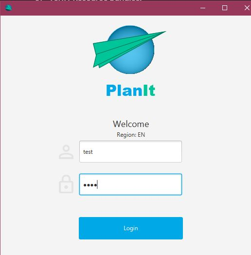
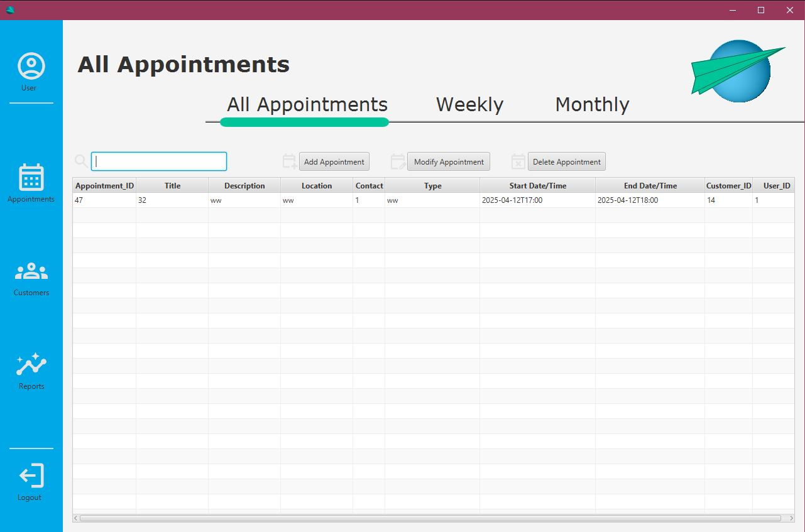
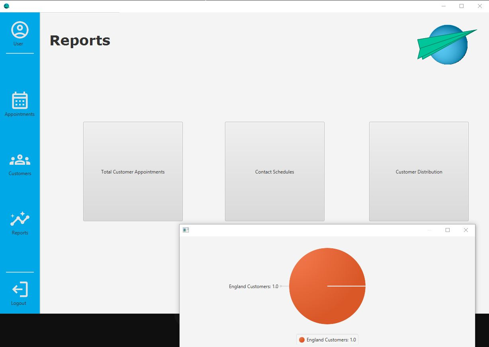

#  PlanIt 
#### (Appointment & Customer Scheduling System)


> **Multi-lingual JavaFX desktop CRM and scheduling engine backed by MySQL, featuring automated time-zone normalization, conflict detection, and real-time analytics.**

---

### // Key Features

* **Automatic Localization (`i18n`):** Detects the host operating system's default locale at launch and dynamically renders the login interface and error alerts.
* **Time-Zone & Conflict Guardrails:** Accepts appointment times in the user's local system time and converts them to **Eastern Time (`8:00 AM – 10:00 PM EST`)**, while blocking overlapping appointments for the same customer.

* **Proactive Alerts & Security Auditing:** Scans upcoming schedules upon login to trigger an alert if an appointment starts within **15 minutes**, and logs all successful and failed authentication attempts.
* **Full CRUD & Referential Integrity:** Supports creating, reading, updating, and deleting customer records and appointments in MySQL, enforcing cascading deletes so removing a customer cleanly purges dependent appointments.

**Reporting & Visual Analytics:**
        <br> • Breakdown of total appointments by type and month.
        <br> • Filterable weekly and monthly calendar views with individual schedules for contacts and system users.
        <br> • Customer Regional Distribution Report: Interactive JavaFX Pie Chart visualizing customer concentration across geographic regions.

---

##  Quick Start

### // Prerequisites
* **JDK 11+** and **JavaFX SDK 17+**
* **MySQL Server 8.0+** (with the schema populated and `mysql-connector-java-8.0.26` linked)
* **IntelliJ IDEA** (or any Java IDE configured with JavaFX VM arguments)

### // Installation & Setup
1. **Clone the repository:**
   ```bash
   git https://github.com/Lund-Structures/PlanIt.git
   cd PlanIt
   ```
2. Configure the Database Connection:

    Start your local MySQL service.

    Update the JDBC connection URL, username, and password in your database connection utility class to match your local MySQL instance.

3. Verify Resource Bundles:

    Ensure `Messages.properties` and `Messages.FR.properties` reside inside your designated resources directory so 
    ResourceBundle resolves them at runtime.

4. Configure JavaFX VM Options (IntelliJ IDEA):

    Open Run > Edit Configurations > Modify options > Add VM options and point to your local JavaFX lib folder:
   ```bash
   --module-path "/path/to/javafx-sdk-17.0.6/lib" 
   --add-modules javafx.controls,javafx.fxml
   ```
5. Execute Main.java and sign in using the **demo credentials**:

   Username: **test**

   Password: **test**

## // Interface & Responsive Layout


|                                                     |                                          |
|:----------------------------------------------------------------------------------------------------:|:-----------------------------------------------------------------------------------------------------:|
| **Localized Login & Audit:** Auto-detects English/French OS settings and logs authentication events. | **Schedule & Customer Hub:** Full CRUD management with weekly/monthly filtering and 15-minute alerts. |

||
|:---:|
| **Analytics & Reports:** Breakdown by type/month plus a regional customer distribution pie chart. |

---

## // Project Structure

```text
appointment-scheduler/
├── README.md                          # Project documentation & setup guide
├── pom.xml                            # Maven build & dependency configuration
├── login_activity.txt                 # Runtime authentication audit log
├── screenshots/                       # UI captures rendered in this README
├── target/JavaDoc/                    # Generated HTML API documentation (index.html)
│
└── src/main/
    ├── java/
    │   ├── module-info.java           # Java module declarations & JavaFX exports
    │   │
    │   ├── com/student/appointment_scheduler/
    │   │   └── Main.java              # Application entry point & primary stage loader
    │   │
    │   ├── controller/                # JavaFX View Controllers (Event & UI logic)
    │   │   ├── LoginController.java
    │   │   ├── MainMenuController.java
    │   │   ├── AppointmentController.java
    │   │   ├── CustomerController.java
    │   │   ├── UserCardController.java
    │   │   └── ReportController1.java ... ReportController3.java
    │   │
    │   ├── model/                     # Domain Entities, Alert Builders & Audit Models
    │   │   ├── Appointment.java
    │   │   ├── Customer.java
    │   │   ├── Contact.java
    │   │   ├── User.java
    │   │   ├── Country.java / CountryDivision.java / FirstLvDivision.java
    │   │   ├── Report1.java / Report2.java
    │   │   ├── CustomAlerts.java
    │   │   └── LoginTracker.java
    │   │
    │   └── Util/                      # Database Connectivity, Time Conversion & DAO Layer
    │       ├── JDBC.java              # MySQL connection lifecycle manager
    │       ├── DataQuery.java         # PreparedStatement execution helper
    │       ├── TimeHelper.java        # Local-to-EST business hour & UTC conversions
    │       └── DAO/                   # Data Access Object Interfaces & MySQL Implementations
    │           ├── AppointmentDAO.java / AppointmentDAOImp.java
    │           ├── CustomersDAO.java   / CustomersDAOImp.java
    │           ├── ContactDAO.java     / ContactDAOImp.java
    │           ├── CountryDAO.java     / CountryDAOImp.java
    │           ├── CountryDivisionDAO.java / CountryDivisionDAOImp.java
    │           └── UserDAO.java        / UserDAOImp.java
    │
    └── resources/
        ├── Messages.properties        # Default English localization strings
        ├── Messages_FR.properties     # French localization strings
        ├── com/student/views/         # FXML layout definitions (Login, Dashboard, CRUD, Reports)
        └── images/                    # Application branding (PlanitLogo.png) & Material UI icons
   ```
    


// Development Environment:

    IDE: IntelliJ IDEA 2024.2.3 (Community Edition)
         Build #IC-242.23339.11, built on September 24, 2024
         Runtime version: 21.0.4+13-b509.17 amd64 (JCEF 122.1.9)
         VM: OpenJDK 64-Bit Server VM by JetBrains s.r.o.
         Toolkit: sun.awt.windows.WToolkit
         Windows 10.0
         GC: G1 Young Generation, G1 Concurrent GC, G1 Old Generation

    java version "17.0.12" 2024-07-16 LTS

    JDK: 11.0.16

    JavaFX: JavaFX SDK 17.0.6

    MySQL Connector Driver: mysql-connector-java-8.0.26
